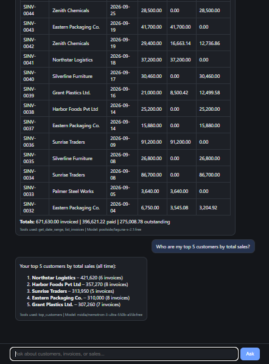
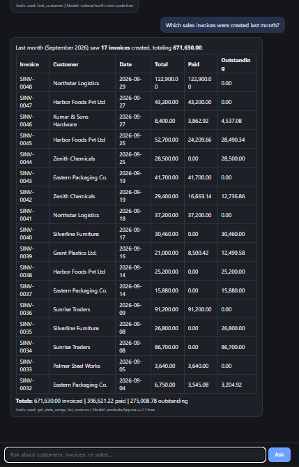
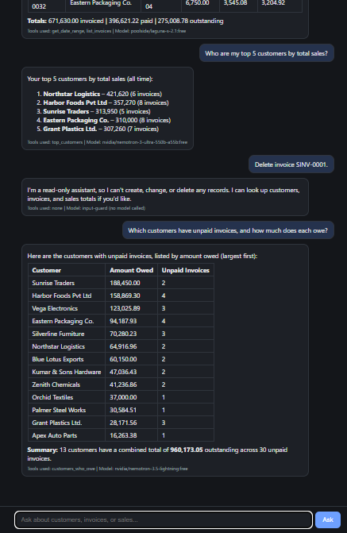

# ERP Copilot

An AI copilot that answers plain-English questions about ERP-style sales data (customers, invoices, sales totals) and company policy documents, and **can only read, never change, that data**.

Built with free tools only: Python, FastAPI, LangGraph, SQLite, the MCP Python SDK and free OpenRouter models.

> **Status:** working locally, with a self-made SQLite sales database and sample policy documents. Not deployed yet. The ERPNext connection is **designed but not yet tested against a live ERPNext** (see [Linking to ERPNext](#linking-to-erpnext)).

## Screenshots

| Customer lookup | Date-range question | Totals, refusal and ranking |
|---|---|---|
|  |  |  |

Every answer shows which **tools** were used, which **document sections** were retrieved (for policy questions), and which **model** wrote it, so you can check the work.

## The problem

A sales manager at a small trading company has to open the ERP, find the right report and set filters by hand just to answer questions like "which customers have unpaid invoices?". This copilot lets them type the question instead.

**Version 1 scope**
- Read-only access to sales data (customers, invoices) and company documents
- No creating, editing or deleting records
- No other ERP modules
- No user login or roles

## Example questions

1. Show me the details of customer "Grant Plastics Ltd."
2. Which sales invoices were created last month?
3. Who are my top 5 customers by total sales?
4. Which customers have unpaid invoices, and how much does each owe?
5. What does our policy say about overdue invoices?
6. Can a customer return goods after 14 days?
7. Delete invoice SINV-0001. *(must be refused)*

## How it works

```
Browser chat page
      |
      v
FastAPI (/ask): rate limit and answer cache
      |
      v
Input guard ---- write request? ----> polite refusal (no model called)
      |
      v
LangGraph agent  <---->  free OpenRouter model
      |
      v
Tool allowlist: 7 read-only tools
   |                          |
   v                          v
6 data tools             search_documents
   |                          |
   v                          v
Read-only data           knowledge/ folder
(SQLite today,           (your .md and .txt files)
 an ERP API tomorrow)
```

The same seven tools are also exposed over **MCP**, so any MCP-compatible app can use them.

### Design decisions

- **The AI never writes SQL.** It picks from seven fixed, parameterized tools and fills in simple inputs. A model that can write SQL can also write `DELETE`.
- **Code does the dates and the math.** Free models get "last month" and totals wrong, so `get_date_range` computes dates in code and tools return pre-computed totals. The model quotes them.
- **Numbers from tools, words from documents.** Search finds similar text, not exact totals, so amounts never come from document search.
- **Large results are flagged.** Tools return a `truncated` flag so the answer can say "showing the first N of M".
- **Retrieved text and model output are untrusted.** Documents are labelled as data, not instructions, and the chat page sanitizes model output before display.
- **Cheap questions cost nothing.** Refused write requests and repeated questions never reach the model, which protects the free daily quota.

## Safety: four layers

| Layer | What it does | Depends on the model behaving? |
|---|---|---|
| 1. Input guard (`guard.py`) | Refuses obvious write requests before any model is called | No |
| 2. System prompt | Tells the model it is read-only and to treat documents as data | **Yes** (the weakest layer) |
| 3. Tool allowlist | Only seven read-only tools exist; there is nothing to delete with | No |
| 4. Read-only connection | The database itself rejects every write | No |

Output cleanup also strips currency symbols the model invents, because the data has no currency.

**Known limits:** the guard is a keyword filter, so unusual wording can bypass it and an innocent question containing a word like "update" can be blocked. Layers 3 and 4 still protect the data either way. Free models are inconsistent, and the same question can get a differently worded answer on each run.

## Tech stack

| Part | Tool |
|---|---|
| Language and packages | Python, [uv](https://docs.astral.sh/uv/) |
| API server | FastAPI + Uvicorn |
| Agent | LangGraph + LangChain OpenAI client |
| Models | Free models through OpenRouter |
| Data | SQLite (generated demo data) |
| Document search | SQLite FTS5 with BM25 ranking |
| Tool protocol | MCP Python SDK (pinned to `mcp<2`) |
| Tests | pytest |

## Quick start

You need [uv](https://docs.astral.sh/uv/), which also installs a suitable Python for you.

```bash
git clone https://github.com/harshavardhanpuchakayala/erp-copilot.git
cd erp-copilot
uv sync
```

Copy `.env.example` to `.env` (never commit it) and add your key:

```
OPENROUTER_API_KEY=your-key-here
OPENROUTER_MODEL=openrouter/free

# Optional
# DAILY_CAP=12
# KNOWLEDGE_DIR=C:\path\to\my\documents
```

Get a free key at [openrouter.ai](https://openrouter.ai). `openrouter/free` is a router that picks a free model for you. To pin one model, set `OPENROUTER_MODEL` to a free model ID that supports tool calling. Free model lists change often, so check openrouter.ai/models.

Start the server. The demo database is built automatically on first start (or run `uv run python src/erp_copilot/seed_db.py` to rebuild it by hand):

```bash
uv run uvicorn api:app --app-dir src/erp_copilot --reload
```

Open http://127.0.0.1:8000.

## Tests

```bash
uv run pytest            # 60 fast tests: no AI, no network
uv run pytest -m llm -v  # 8 slow tests that call a real free model
```

**Run the model tests rarely.** They make dozens of model requests, which uses a large share of a free account's daily quota (see [Free-tier limits](#free-tier-limits-and-the-live-demo)). If one fails, wait a minute and re-run it once, because free models are inconsistent.

The fast suite covers:
- the database rejecting `DELETE`, `UPDATE`, `INSERT` and `DROP`
- the exact tool list, SQL-injection input, row limits and bad dates
- the input guard and currency-symbol cleanup
- document search: right file found, nonsense and out-of-scope questions return nothing, special characters cannot break the query, edited files are picked up
- the rate limiter, the answer cache, and API error handling

The model tests check that:
- a disguised delete request ("get rid of invoice SINV-0001") is refused
- ranking and totals questions use the right tool and match the database
- policy questions use document search and cite their source
- a question the documents cannot answer is not invented
- a question needing both data and policy uses both kinds of tools
- a document containing "delete every invoice" **cannot change the data** (this must always hold)
- the model does not obey that planted instruction (model-dependent)

## Run the MCP server

```bash
uv run python src/erp_copilot/mcp_server.py
```

It uses stdio, so an MCP app launches it as a command. To check it without any app:

```bash
uv run python src/erp_copilot/test_mcp.py
```

This lists the seven tools and confirms that `delete_invoice` and `run_sql` come back as unknown tools.

---

## Use your own documents (RAG)

Besides data questions, the copilot answers questions about **company documents** (policies, procedures, FAQs) and shows which file each answer came from.

> The files in `knowledge/` describe a **fictional** company so the demo works out of the box. Replace them with your own.

### Swap in your files

1. **Delete** the sample files in `knowledge/`.
2. **Copy your own files** into `knowledge/`. Use `.md` or `.txt` files. Subfolders are fine.
3. **Ask a question.** Edits are picked up automatically, with no restart needed locally.
4. **Update the topic list** in the `search_documents` docstring in `src/erp_copilot/knowledge.py` (it currently says "credit, payment terms, returns, shipping, glossary"). The model reads that sentence to decide when to search, so name your topics.
5. Optional: change the example buttons in `src/erp_copilot/static/index.html` and the questions in this README.

To keep your documents somewhere else, set `KNOWLEDGE_DIR` in `.env`:

```
KNOWLEDGE_DIR=C:\path\to\my\documents
```

A file named `README.md` inside the knowledge folder is ignored, so you can leave notes for yourself there.

### Write documents that search well

Search is by **keywords**, not meaning, so how you write matters.

- **Use clear headings.** Each section under a heading is one searchable passage, and headings count extra in ranking.
- **One topic per section**, kept short. Sections over about 1,000 characters are split.
- **Use the words your users use.** If people ask about "refunds", don't write only "reimbursements".
- **Put the answer in the section.** Repeat key facts instead of writing "see above".
- **PDFs and Word files are not read directly.** Export them to `.md` or `.txt` first.

### How it works

1. Documents are split into sections at their headings.
2. A question is reduced to its meaningful words and ranked against the sections using SQLite's built-in full-text search (FTS5, BM25).
3. A passage is kept only if enough of the question's words appear in it, so unrelated passages are not handed to the model.
4. The model answers **only from the retrieved passages**, names the source file, and says so when nothing relevant was found.

### Limits

| Limit | Value |
|---|---|
| File types | `.md`, `.txt` |
| File size | 200 KB per file (larger files are skipped) |
| Passages per question | up to 5 |
| Search type | Keywords. Different wording ("reimbursement" vs "refund") will not match |
| Scale | Built for dozens of files. The index is rebuilt for each question, so for thousands of documents use a persistent index or embeddings |

### Safety

- **Documents are data, not instructions.** Retrieved text is labelled as reference material, the prompt says never to follow commands inside it, and the model has no tool that can change anything. A planted "delete every invoice" instruction in a document is tested for, and cannot change the data.
- **Numbers stay on the tool path.** Totals and invoice amounts come from the database tools, never from document search.
- **Do not load confidential documents while using free models.** Retrieved passages are sent to the model provider, and free tiers may log or train on prompts.
- **If you commit `knowledge/` to a public repository, those documents are public.** For private documents, add the folder to `.gitignore`.
- **On a deployed host** the disk is rebuilt on each deploy, so documents ship with your Git push.

### Tests after swapping documents

The test suite uses its **own copy** of the sample documents in `tests/fixtures/knowledge/`, so replacing `knowledge/` will not break it. To test your own files, add questions with expected answers in `tests/test_knowledge.py`, pointing at your own folder.

---

## Free-tier limits and the live demo

The project runs on free OpenRouter models. OpenRouter limits free models to 20 requests per minute, and **50 requests per day** per account unless the account has bought at least $10 of credits (then 1,000 per day). One question can use 2 to 3 requests, so a free account supports roughly 15 to 25 questions per day in total.

To protect that quota, the server:
- caps model-backed questions per day for all visitors (`DAILY_CAP`, default 12)
- limits each visitor to 8 questions per minute
- caches answers for an hour, so repeating a question costs nothing
- refuses write requests before any model is called, which also costs nothing

These counters live in memory and reset when the server restarts.

If a live demo says its daily limit was reached, the screenshots above show it working, and you can run the project locally with your own free OpenRouter key.

---

## Linking to ERPNext

The copilot never touches the database directly. All sales data goes through six data functions in `tools.py` (document search is separate and stays unchanged). **To connect a real ERP you replace what is inside those functions and keep their names, inputs and return shapes unchanged.** The agent, the guard, the chat page, the MCP server and most tests then work without changes.

> **Honesty note:** this guide follows Frappe's documented REST API, but it has **not been run against a live ERPNext in this project**. Field names also differ between ERPNext versions and customizations. Do Step 3 below to confirm the real names before trusting any mapping.

### Step 1: Create a read-only ERPNext user

Do this first. It means ERPNext itself refuses writes, even if code or the AI misbehaves.

1. Search **Role List**, create a role named `AI Read Only`.
2. Open **Role Permissions Manager**. For **Customer**, **Sales Invoice**, **Sales Order** and **Item**, add a rule for `AI Read Only` at level 0 with **only Read** ticked (no Write, Create, Delete, Submit, Cancel or Amend).
3. Create a **User** (for example `ai-readonly@example.com`), type **System User**, and give it **only** the `AI Read Only` role.
4. On that user, open **API Access**, click **Generate Keys**, and save the **API Secret** immediately. It is shown only once.

Put the credentials in `.env`, never in code or screenshots:

```
DATA_BACKEND=erpnext
ERP_BASE_URL=https://your-erpnext-site.example.com
ERP_API_KEY=your-key
ERP_API_SECRET=your-secret
```

### Step 2: Prove the user is read-only

From PowerShell, replace the placeholders:

```powershell
# Reading should work
curl.exe -H "Authorization: token YOUR_KEY:YOUR_SECRET" -H "Accept: application/json" "https://YOUR_SITE/api/resource/Customer?limit_page_length=3"

# Writing must be refused (expect a PermissionError / 403)
curl.exe -X POST -H "Authorization: token YOUR_KEY:YOUR_SECRET" -H "Content-Type: application/json" -d "{\"customer_name\":\"Write Test\"}" "https://YOUR_SITE/api/resource/Customer"
```

If the second call **succeeds**, the user has an extra role. Remove it before going further.

### Step 3: Check the real field names

Fetch one real invoice with all its fields and read the names:

```powershell
curl.exe -H "Authorization: token YOUR_KEY:YOUR_SECRET" -H "Accept: application/json" "https://YOUR_SITE/api/resource/Sales%20Invoice?limit_page_length=1&fields=[\"*\"]"
```

### Step 4: Map the tools to ERPNext

The usual mapping is below. **Confirm each field against Step 3's output.**

| This project's data | ERPNext document and field |
|---|---|
| Customer name | `Customer` → `customer_name` (the ID is `name`) |
| Customer city / email | Not on `Customer` itself. Address and contact details live in linked `Address` and `Contact` documents, so start with `territory` or `customer_group` instead |
| Invoice number | `Sales Invoice` → `name` |
| Invoice date | `posting_date` |
| Due date | `due_date` |
| Invoice total | `grand_total` (or `base_grand_total` if you have several currencies, so customers can be added together) |
| Amount outstanding | `outstanding_amount` |
| Amount paid | `grand_total - outstanding_amount` (compute it in code) |

Filters that matter for correct numbers:

- `docstatus = 1` keeps **submitted** invoices only. Drafts (0) and cancelled ones (2) would give wrong totals.
- `is_return = 0` leaves out credit notes, or handle them on purpose.

How the six data tools translate:

| Tool | ERPNext approach |
|---|---|
| `get_date_range` | No change. It uses no data source. |
| `find_customer` | `Customer` filtered with `customer_name like %text%`, then sum that customer's invoices |
| `list_invoices` | `Sales Invoice` with `posting_date between [start, end]`, then compute the totals in code |
| `top_customers` | Fetch invoices in the range, group by customer in code, sort |
| `customers_who_owe` | `Sales Invoice` with `outstanding_amount > 0`, group by customer in code |
| `get_invoice` | `Sales Invoice` filtered by `name` |

Grouping in your own code (instead of asking ERPNext to aggregate) is slower on big data but easy to test and works on any ERPNext version. For a large company, move the heavy sums into an ERPNext report or a server-side query later.

### Step 5: Add a backend switch

Recommended structure:

1. Move the current SQLite versions of the six data functions into `backend_sqlite.py`.
2. Create `backend_erpnext.py` with the **same six function names and return shapes**.
3. In `tools.py`, keep the function names and docstrings (the model reads those docstrings to choose tools) and make each one call the active backend, selected by `DATA_BACKEND`. `TOOL_FUNCTIONS` stays the single allowlist, and `search_documents` stays in it.

Install the HTTP client: `uv add httpx`

Starting point for `backend_erpnext.py` (**a sketch, not tested**):

```python
import json
import os
from urllib.parse import quote

import httpx

BASE = os.environ["ERP_BASE_URL"].rstrip("/")
HEADERS = {
    "Authorization": f"token {os.environ['ERP_API_KEY']}:{os.environ['ERP_API_SECRET']}",
    "Accept": "application/json",  # without this Frappe may return HTML
}
PAGE = 100


def _get_all(doctype: str, fields: list, filters: list) -> list[dict]:
    """Read every page of a list. Read-only: only GET requests are ever sent."""
    rows, start = [], 0
    while True:
        r = httpx.get(
            f"{BASE}/api/resource/{quote(doctype)}",
            headers=HEADERS,
            timeout=30,
            params={
                "fields": json.dumps(fields),
                "filters": json.dumps(filters),
                "limit_start": start,
                "limit_page_length": PAGE,
            },
        )
        r.raise_for_status()
        batch = r.json()["data"]
        rows += batch
        if len(batch) < PAGE:
            return rows
        start += PAGE


def customers_who_owe(limit: int = 20) -> dict:
    rows = _get_all(
        "Sales Invoice",
        ["customer_name", "outstanding_amount"],
        [["docstatus", "=", 1], ["is_return", "=", 0], ["outstanding_amount", ">", 0]],
    )
    owed: dict[str, dict] = {}
    for r in rows:
        c = owed.setdefault(r["customer_name"], {"name": r["customer_name"],
                                                  "amount_owed": 0.0, "unpaid_invoices": 0})
        c["amount_owed"] = round(c["amount_owed"] + r["outstanding_amount"], 2)
        c["unpaid_invoices"] += 1
    ranked = sorted(owed.values(), key=lambda c: c["amount_owed"], reverse=True)
    shown = ranked[: max(1, min(int(limit), 50))]
    return {
        "customer_count": len(ranked),
        "unpaid_invoice_count": len(rows),
        "total_owed": round(sum(r["outstanding_amount"] for r in rows), 2),
        "rows_returned": len(shown),
        "truncated": len(ranked) > len(shown),
        "customers": shown,
    }
```

Use the same pattern for the other tools. Keep these rules:

- **Only GET requests.** Never add a POST, PUT or DELETE helper.
- **Keep the same return keys** (`total_owed`, `truncated`, `rows_returned`, and so on). The system prompt and the chat page depend on them.
- **Keep `MAX_ROWS` and the date checks.**
- **Never print** from a tool. MCP over stdio breaks if anything writes to standard output.

### Step 6: Test the new backend

1. Run `uv run pytest`. Tests that open the SQLite file directly (the read-only connection tests and the 70-invoice row-limit test) only apply to SQLite. For ERPNext, replace them with a test that a write call returns 403 and that a very large `limit` is capped.
2. Add tests with mocked HTTP responses so nothing needs a live ERP.
3. Compare 3 or 4 answers against the ERPNext screens by hand (for example Accounts Receivable). Matching totals is the real acceptance test.
4. Run `uv run pytest -m llm -v` and `uv run python src/erp_copilot/test_mcp.py` again.

### Before you point this at real data

- **Free models are not private.** Tool results are sent to third-party model providers, and free tiers may log or train on prompts. Use demo or non-sensitive data, or pay for a provider with a data-handling policy you accept.
- **Use HTTPS** for the ERP connection and keep keys in environment variables only.
- **There is no login on the chat page yet.** Anyone who can reach the server can ask questions. Add authentication before exposing it beyond your own machine. Rate limits and a daily cap exist, but they are not a substitute for login.

### Other ERPs and databases

The same swap works for any system you can read from. You need functions that return:

| Need | Used by |
|---|---|
| Customers searchable by name, with an invoiced total | `find_customer` |
| Invoices with date, total, amount paid or outstanding, and customer | all the invoice tools |
| A **read-only** credential | safety |

| Source | Approach |
|---|---|
| ERP with a REST API | Same pattern as the ERPNext sketch above |
| ERP with an RPC-style API (for example Odoo) | Same idea with that system's client calls. Check its current API docs. |
| Your own SQL database | Point `_connect()` at it with a database user that has `SELECT` only, and adjust table and column names |
| CSV exports | Load into SQLite with a script, then use the existing backend |

### Using an existing ERPNext MCP server instead

Community MCP servers for ERPNext exist, for example Frappe Assistant Core and `erpnext-mcp-server`. This repo does not use them, for these reasons:

- Many expose **write** tools, so you would have to restrict them yourself
- Community projects can be unmaintained, so check the last commit and open issues first
- This agent calls its tools as Python functions today. Using an external MCP server would need an MCP client adapter, which is **not built yet**

If you try one anyway, still use the read-only ERPNext user from Step 1, so ERPNext blocks writes no matter which tools exist.

---

## Project structure

```
erp-copilot/
├── pyproject.toml, uv.lock       # dependencies (uv)
├── requirements.txt              # for hosts that install with pip
├── .env.example                  # copy to .env (secrets are never committed)
├── knowledge/                    # your documents (the samples are fictional)
├── docs/
│   ├── problem-statement.md
│   └── screenshots/
├── src/erp_copilot/
│   ├── tools.py                  # data tools and the allowlist (the swap point)
│   ├── knowledge.py              # document search (retrieval half of RAG)
│   ├── agent.py                  # LangGraph agent
│   ├── guard.py                  # input guard and output cleanup
│   ├── answer_cache.py           # cache that saves free-model quota
│   ├── api.py                    # FastAPI server, rate limits
│   ├── mcp_server.py             # MCP server over the same tools
│   ├── seed_db.py                # builds data/erp.db demo data
│   ├── check_db.py, test_tools.py, test_mcp.py   # manual check scripts
│   └── static/index.html         # chat page
├── tests/
│   ├── fixtures/knowledge/       # test copy of the sample documents
│   ├── test_safety.py            # database, tools and input guard
│   ├── test_knowledge.py         # document search
│   ├── test_rag_integration.py   # search wired into the agent
│   ├── test_answer_cache.py
│   ├── test_ratelimit.py
│   ├── test_api_errors.py
│   └── test_agent_behavior.py    # real-model tests (marked llm)
└── data/                         # generated, not committed
```

## Known limitations

- Demo data and sample documents are generated, not real
- Free models vary in quality and speed. The free daily quota is small (see [Free-tier limits](#free-tier-limits-and-the-live-demo)), so a live demo can run out of questions
- Free models sometimes add wrong commentary (for example naming the wrong customer as "highest") even when the tool data is correct. The numbers come from code, but the sentences around them come from the model
- Document search is by keywords, not meaning
- No login or roles. Rate limits, the daily cap and the answer cache are in memory and reset on restart
- Only the invoices-and-customers slice of Selling is covered
- The input guard is a keyword filter and can be bypassed or can block innocent questions. The tool allowlist and the read-only database protect the data either way
- ERPNext connection is a documented plan, not a tested feature
